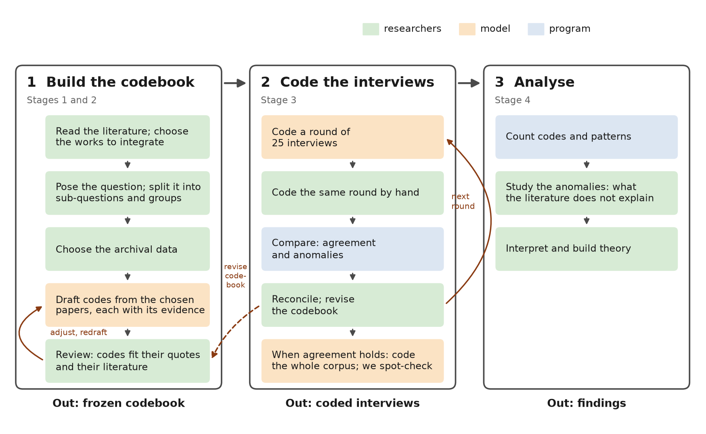
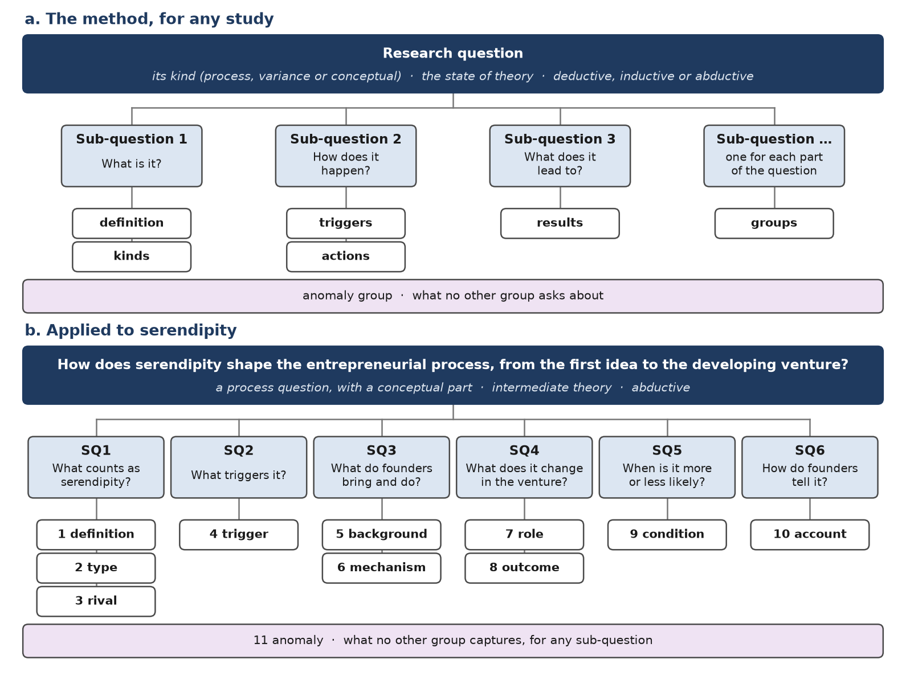
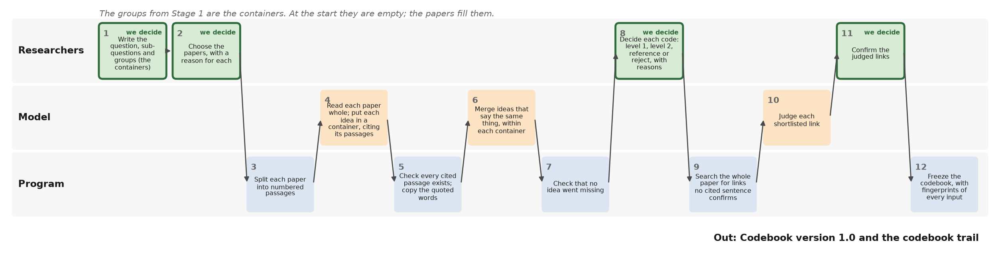
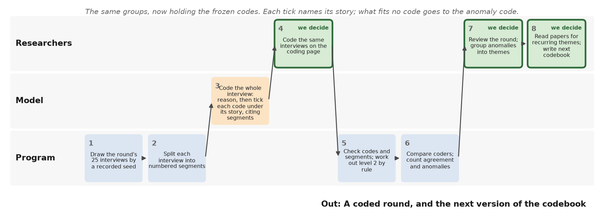

# A literature-to-coding harness for qualitative research

Technical appendix, draft 2, for discussion. Vyas Sreenivas and Ravi S. Kudesia. 26 October 2026.

Qualitative research has two broad modes. In the first, researchers collect their own data and build theory inductively, refining their questions as they go. In the second, a large body of text already exists, such as thousands of published founder interviews, and researchers bring concepts from the literature to it.

The harness serves the second mode. It applies existing theory to large archival text and keeps what the theory does not explain as anomalies to theorize from, which makes the approach abductive (Timmermans and Tavory 2012). It works in three boxes (Figure 1). Our worked example is serendipity in founder interviews from Starter Story.

*Figure 1. The harness. Each step is coloured by who does it. In box 1 we review the model's draft until the codebook freezes. In box 2 we compare our coding with the model's, round by round, and changes go back to the codebook.*

## Who does what

Three kinds of actor share the work, and each step goes to the one suited to it.

| Who | What they do | Why |
|---|---|---|
| Us, the researchers | Set the question, choose the papers, decide every code, review every round | These are research decisions |
| The model | Reads papers and interviews, and proposes | Reading for meaning, at a scale people cannot manage |
| A program | Splits, numbers, copies, checks, counts and applies rules | It gives the same output for the same input, costs nothing, and anyone can rerun it |

The model only proposes. A program checks everything it produces, and nothing it produces is final until we decide. We step in at five points: we set up the study, choose the papers, decide the codebook, confirm the evidence, and review each round of coding. The process page lists every step with its files and records.

## Stage 1. From the research question to groups

We start by reading the literature closely and choosing the works whose views are worth integrating. We then name what kind of question we are asking. We then split it into sub-questions and turn each sub-question into analysis groups: the questions a coder asks of the data. An anomaly group holds whatever no other group asks about. Figure 2a shows the method for any study, and Figure 2b shows it for serendipity.

*Figure 2. Stage 1. (a) The method for any study. (b) Applied to serendipity: one research question, six sub-questions and eleven analysis groups.*

| Step | What we do |
|---|---|
| 1 Choose the literature | Read the literature closely; choose the seminal works whose views differ and are worth integrating, and the assumptions worth questioning |
| 2 Name the kind of question | Decide whether it asks how something happens, what explains differences, or what something is |
| 3 Split it into parts | List the topic, the action, the time span, the people, the place and the data |
| 4 Write sub-questions | Write the standard sub-questions for that kind of question, in the study's own terms |
| 5 Trace and test each one | Keep a sub-question only if it comes from the main question, the data can answer it and it repeats no other |
| 6 Write the analysis groups | Turn each sub-question into the questions asked of every part of the data, and add an anomaly group |
| 7 Choose the data | Choose an archival source whose texts can answer the sub-questions |

*Table 1. The steps of Stage 1, following Sandberg and Alvesson (2011), Maxwell (2009), Podsakoff et al. (2016) and Staller (2022).*

The groups are containers. In Stage 2 the papers fill them; in Stage 3 the interviews are sorted into them.

**For serendipity.** Table 2 gives the six sub-questions. We read the papers for ten groups and an anomaly group (Figure 2b). When we decided the codebook, the definition and type groups became one group, the parts of serendipity, and the definitions, types and rival explanations became level-2 rules. Coders therefore answer eight groups.

| SQ | Sub-question | Codebook groups |
|---|---|---|
| 1 | What counts as serendipity: are its parts (surprise, agency, value) present, what was the search state, which type is it, and is it more than luck or targeted search? | Parts of serendipity; the definitions, types and rival explanations are worked out from it at level 2 |
| 2 | What triggers it: an anomaly, an error, a chance meeting, a passing remark, an unsought offer, or a market signal? | Trigger |
| 3 | What background (prior knowledge, a problem in mind, contacts) and which mechanisms (noticing, connecting, acting, changing plans) turn the trigger into an opportunity? | Background; Mechanism |
| 4 | What role does it play in the venture (founding, redirecting, advancing it), and what outcomes follow: a product, a market, growth, or nothing? | Role; Outcome |
| 5 | Which conditions make it more or less likely to occur and be acted on: seeking out chance, cheap trials, loose plans, or scarce resources? | Condition |
| 6 | How do founders account for it afterwards: as luck, as luck plus effort, as clear only in hindsight, or retold as planned? | Account |

*Table 2. The six sub-questions for serendipity, and the codebook groups that answer each. Each group also has an anomaly code, and one more takes what no group asks about.*

## Stage 2. From papers to codebook

The groups from Stage 1 are the containers. At the start they are empty. Figure 3 shows how the papers fill them, and who does each step.

*Figure 3. Stage 2. Each box is one step, in the lane of whoever does it. Outlined boxes are where we decide.*

1. **We write the question, sub-questions and groups,** before any paper is read.
2. **We choose the papers,** with a reason for each.
3. **A program splits each paper into numbered passages.** Coding breaks text into segments, so the rules for where a segment starts and ends should be explicit (MacQueen et al. 1998). Ours are: about 1,200 characters, always ending at a sentence. The numbers let the model cite a passage instead of typing a quotation, so it cannot invent evidence.
4. **The model reads each paper whole** and puts each idea into one container, citing the passages that state it.
5. **A program checks** that every cited passage exists, and copies the quoted words from the paper.
6. **The model merges ideas that say the same thing,** within each container. Ideas that fit no container are set aside, with a reason.
7. **A program checks** that every idea was either merged or set aside.
8. **We decide each code:** coders tick it (level 1), it is worked out from other codes (level 2), it stays as reference, or it is rejected. Every decision has a reason.
9. **A program searches the whole paper** for any link between a code and a paper that no cited sentence confirms, and lists the closest sentences.
10. **The model judges each listed link:** the sentence states the code, leans on it, or does not.
11. **We confirm those judgments.**
12. **A program freezes the codebook,** with a fingerprint of every file it was built from.

**Two levels.** Merging works within one container: the same idea from many papers becomes one code. The second level works across them. Some papers define a concept as a combination of parts, such as a definition whose conditions must all hold (Podsakoff et al. 2016). We keep each such combination as a rule over level-1 codes, not as a code coders tick. Vila-Henninger et al. (2024) call such rules code equations: codes joined by AND and OR to capture what no single code holds. Ours also allow NOT, so that luck can be defined as surprise and value without agency. Coders tick only what they can point to; the rules are worked out afterwards, much as first-order codes lead to second-order themes (Fereday and Muir-Cochrane 2006; Gehman et al. 2018).

**For serendipity.** The model read 113 files, which make 100 works once the chapters of one book are counted together, and proposed 1,893 candidate codes, merged into 369 drafted codes. Codebook version 1.0 has 36 level-1 codes in eight groups, one of them a single-answer question about what the founder was doing when it happened. It also has an anomaly code for each group and one for anything no group asks about. Its 11 level-2 items are three definitions of serendipity, two rival explanations, four types and two judgments we make ourselves. Of the 473 links between a code and a paper, 408 were confirmed by a cited sentence and 19 more on the second search of the whole paper. The other 46 are recorded as checked but not confirmed. The level-2 items first took their papers from the drafted codes they came from; we read each sentence against its rule and kept only those that state it. Of the 100 works, 73 state at least one code. A program then found the smallest set of them that together state every code, each code by two of them wherever two do: 14 papers, which the paper list gives with why each matters. The codebook trail and the code sources table show every code with its papers and sentences.

## Stage 3. Coding the interviews in rounds of 25

The containers are the same groups, now holding the frozen codes. Each interview is coded whole, as qualitative coding usually is: wherever a passage shows a code, the coder ticks it and cites the segments. Each tick also names the story it belongs to, one thread of the founder's journey such as "the café order". The stories need no prior decision about what counts; they are simply what the coded passages are about. The level-2 rules are worked out story by story, so codes from different stories are never combined, and a story can come out as serendipity, as pure luck or as a plan. What fits no code goes to that group's anomaly code (Figure 4). The codes guide the coding but do not confine it, as in hybrid thematic analysis (Fereday and Muir-Cochrane 2006). The anomaly codes do the work of negative case analysis: they collect evidence that contradicts, refines or expands the theory, not only evidence that supports it (Fife and Gossner 2024). The interviews were not ours, so we cannot ask a founder about something left unsaid. A missing code is therefore not evidence that something did not happen (Fife and Gossner 2024).

*Figure 4. Stage 3, for one round of 25 interviews. Outlined boxes are where we decide. The last step sends changes back to the codebook, and the next round begins.*

1. **A program draws the round's 25 interviews** by a recorded seed.
2. **A program splits each interview into numbered segments,** one for each question and each answer.
3. **The model reads each interview whole.** It names the stories the interview tells. For each code it first gives a short reason and then its ticks, each naming a story and citing the segments that show it, and it uses the anomaly code, with a reason, when nothing fits.
4. **We code the same interviews** on the coding page, without seeing the model's coding.
5. **A program checks** every code and segment, and works out level 2: which definitions, rival explanations and types each story meets.
6. **A program compares the coders** and counts agreement and anomalies. Each researcher's coding is first turned into the same form as the model's and goes through the same checks. Codes are compared per interview, with Cohen's kappa. Stories are matched across coders by the segments they cite, and level 2 is compared on matched stories. A near miss is an anomaly that another coder covered with a code of the same group on the same segments.
7. **We review the anomalies, near misses, disagreements and false positives,** group the anomalies into themes, and record them in the anomaly log.
8. **We find the papers for each recurring theme and write the next codebook version.** We search catalogues of journal abstracts for the theme, then read the likely papers in full. A paper is kept only if it states the theme. The log records every search, its hits and the papers kept. The theme becomes a code, with those papers or as an inductive code, and the program writes the next version.

**Checking the rules.** A rule can pick out a story that does not show the concept. Vila-Henninger et al. (2024) call this a false positive, and they read every match of a code equation to find them. We do the same in step 7 and record why each false positive fails. Following their rule of thumb, a rule with more false positives than matches is too loose, and we revise it. A false positive can also be an anomaly worth theorizing from.

Rounds of 25 are enough for most codes to appear. Hennink et al. (2017) found codes appeared within 9 interviews and their meaning settled within 16 to 24. Guest et al. (2006) found most codes within 12, but a more varied group added codes later, so we run several rounds. The codebook freezes after the first round that adds no code and changes no code's meaning.

**Growing the codebook.** The codebook starts small and grows. Version 1.0 holds only the 36 codes we chose from the papers; nothing waits on the side to be tried. After each round we group the anomalies into themes. A theme that recurs across interviews becomes a new code in its group, and only then do we look for the papers that state it (step 8). These are research decisions: a model may suggest search terms or candidate papers, but we read every paper we keep. A theme no paper states enters as an inductive code from the data, and the codebook says so. Each new version recodes the earlier rounds and is tested on 25 interviews not yet seen, so a code is never judged only on the interviews it came from. A program keeps one anomaly log across all rounds. Each theme in it is open, adopted as a code in a named version, or dropped with a reason. Open themes carry forward and gain new anomalies as later rounds find them. Those still open when the codebook freezes are reported as findings: what founders say that neither the literature nor the codebook captures. The log names interviews by id and segment only, so it can be published with the codebook. A program also writes a table of every code against every codebook version, with where each code came from and what changed, so a reader can follow how the codebook grew.

**The model as a coder.** Models can apply a codebook written by people. In one test, GPT-4 reached substantial agreement with people on 8 of 9 interpretive codes, after the code wording was adapted for the model (Dunivin 2025). An earlier model reached fair to substantial agreement (Xiao et al. 2023). Agreement rose when the model gave its reasons before deciding, and when each code was a separate task (Dunivin 2025). We adopt the first: the model gives a reason before each code decision. A call per code would multiply the cost, so the harness offers one call per interview or one call per group, and round 1 compares both with our coding. Adapting the wording to one set of interviews can overfit it, so held-out interviews stay unseen until the codebook is frozen (Dunivin 2025).

**Answering the critics.** Critics found that chatbots asked to code invent quotations, give different answers each time and leave no trail (Nguyen and Welch 2026). Schildt (2026) replies that these are failures of chatbots, and that fixed workflows that check every quote against the source avoid them. He asks for two-way transparency: a reader should get from each interpretation to its text, and from the text to what was and was not picked up. The harness answers each point: the model cites numbered segments and a program copies the words, repeated runs measure the model's agreement with itself, and every call is logged. Because every code carries its segment numbers, the coding can be traced both ways.

**Where this stands.** Steps 2 to 8 are built. The model has coded the 25 interviews of round 1 in a Claude Code session, and its 35 anomalies are in the anomaly log. Our own coding of round 1 is next. Step 6 has been tested on made-up researcher coding only. Step 1 is being rebuilt for codebook version 1.0.

## Stage 4. Analyse

**One option: comparing configurations.** Each level-1 code is either present in a story or absent, so the codes can be read as crisp sets. Qualitative comparative analysis can then find which combinations of codes go with an outcome, allowing several paths to the same outcome (Nishant and Ravishankar 2020). Our level-2 rules are combinations fixed in advance by theory; this would find combinations in the data. Turning words into set scores is itself interpretation, so each score should carry its reason and its quotes (Pagliarin et al. 2023). The coding files already keep both for every code. Pagliarin et al. also stress close knowledge of each case, which interviews we did not conduct may not give. The rest of this stage is to be written.

## Data, models and reproducibility

## References

Dunivin, Z. O. (2025). Scaling hermeneutics: A guide to qualitative coding with LLMs for reflexive content analysis. *EPJ Data Science*, 14, 28. doi:10.1140/epjds/s13688-025-00548-8.

Fereday, J., and Muir-Cochrane, E. (2006). Demonstrating rigor using thematic analysis: A hybrid approach of inductive and deductive coding and theme development. *International Journal of Qualitative Methods*, 5(1), 80–92.

Fife, S. T., and Gossner, J. D. (2024). Deductive qualitative analysis: Evaluating, expanding, and refining theory. *International Journal of Qualitative Methods*, 23, 1–12. doi:10.1177/16094069241244856.

Gehman, J., Glaser, V. L., Eisenhardt, K. M., Gioia, D., Langley, A., and Corley, K. G. (2018). Finding theory–method fit: A comparison of three qualitative approaches to theory building. *Journal of Management Inquiry*, 27(3), 284–300.

Guest, G., Bunce, A., and Johnson, L. (2006). How many interviews are enough? An experiment with data saturation and variability. *Field Methods*, 18(1), 59–82.

Hennink, M. M., Kaiser, B. N., and Marconi, V. C. (2017). Code saturation versus meaning saturation: How many interviews are enough? *Qualitative Health Research*, 27(4), 591–608.

MacQueen, K. M., McLellan, E., Kay, K., and Milstein, B. (1998). Codebook development for team-based qualitative analysis. *Cultural Anthropology Methods*, 10(2), 31–36.

Maxwell, J. A. (2009). Designing a qualitative study. In L. Bickman and D. J. Rog (Eds.), *The SAGE Handbook of Applied Social Research Methods* (2nd ed., pp. 214–253). Sage.

Nguyen, D. C., and Welch, C. (2026). Generative artificial intelligence in qualitative data analysis: Analyzing—or just chatting? *Organizational Research Methods*, 29(1), 3–39. doi:10.1177/10944281251377154.

Nishant, R., and Ravishankar, M. N. (2020). QCA and the harnessing of unstructured qualitative data. *Information Systems Journal*, 30(5), 845–865. doi:10.1111/isj.12281.

Pagliarin, S., La Mendola, S., and Vis, B. (2023). The "qualitative" in qualitative comparative analysis (QCA): Research moves, case-intimacy and face-to-face interviews. *Quality & Quantity*, 57, 489–507. doi:10.1007/s11135-022-01358-0.

Podsakoff, P. M., MacKenzie, S. B., and Podsakoff, N. P. (2016). Recommendations for creating better concept definitions in the organizational, behavioral, and social sciences. *Organizational Research Methods*, 19(2), 159–203.

Sandberg, J., and Alvesson, M. (2011). Ways of constructing research questions: Gap-spotting or problematization? *Organization*, 18(1), 23–44.

Schildt, H. (2026). The case for artificial intelligence in qualitative research. *Organization Studies*, 47(9), 1501–1505. doi:10.1177/01708406261452993.

Staller, K. M. (2022). Confusing questions in qualitative inquiry: Research, interview, and analysis. *Qualitative Social Work*, 21(2), 227–234.

Timmermans, S., and Tavory, I. (2012). Theory construction in qualitative research: From grounded theory to abductive analysis. *Sociological Theory*. doi:10.1177/0735275112457914.

Vila-Henninger, L., Dupuy, C., Van Ingelgom, V., Caprioli, M., Teuber, F., Pennetreau, D., Bussi, M., and Le Gall, C. (2024). Abductive coding: Theory building and qualitative (re)analysis. *Sociological Methods & Research*, 53(2), 968–1001. doi:10.1177/00491241211067508.

Xiao, Z., Yuan, X., Liao, Q. V., Abdelghani, R., and Oudeyer, P.-Y. (2023). Supporting qualitative analysis with large language models: Combining codebook with GPT-3 for deductive coding. In *IUI '23 Companion*, 75–78. doi:10.1145/3581754.3584136.
